 

 

Estudio Ingeniería de Sistemas y Computación y trabajo en la intersección de tres cosas: **aplicaciones full stack**, **IoT** y **datos aplicados a salud**. Me interesa el ciclo completo de un sistema, desde modelar el problema hasta desplegarlo y medir si funciona.

### Actualmente

- 🔬 **Semillero Innovar para Servir** (PUJ Cali, desde enero de 2026): programo, reviso y documento un modelo de predicción de capacidad pulmonar.
- 🚗 **JaveCupos**: app de carpooling universitario con GPS en tiempo real y alertas SOS.
- 🍽️ **Come Jave**: API modular en NestJS con cliente web en React.

### Me interesa

`Full stack` · `IoT en tiempo real` · `Datos aplicados a salud` · `Arquitectura de software`

## Proyectos

| Proyecto | Qué resuelve | Stack |
| :-- | :-- | :-- |
| **[JaveCupos](https://github.com/Niko2361920/Pplataformas_n)** | Carpooling universitario con GPS en tiempo real, trayectorias, alertas SOS y modo de simulación IoT | React · TypeScript · Supabase · TanStack Router |
| **[Come Jave](https://github.com/Niko2361920/come-jave-back)** | Plataforma con API modular y cliente web | NestJS · React |
| **Nu Skype** *(freelance)* | Venta de boletas y landing para un evento en Cali, con QR generado en servidor y prevención de fraude en tiempo real | React · Vite · Firebase · Vercel |
| **Predicción de capacidad pulmonar** *(investigación)* | Modelo predictivo desarrollado dentro del semillero Innovar para Servir | Python |

## Stack

## Actividad

## Contacto

